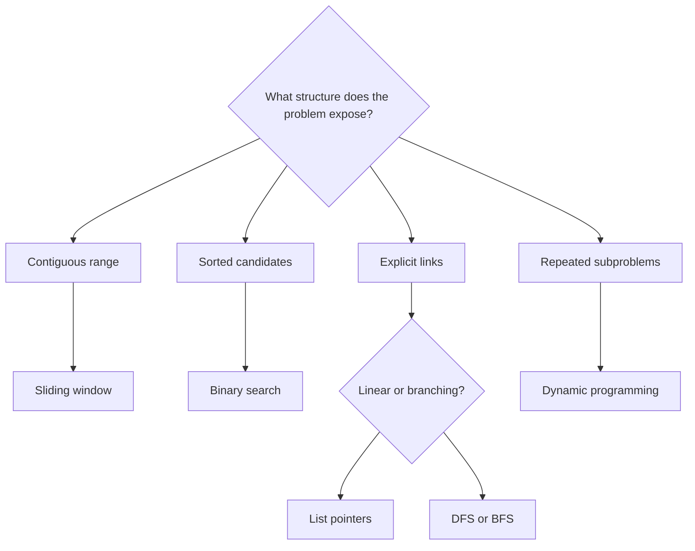

# Pattern atlas

[Problem catalog](problems.md) · [Repository](../README.md) · [Roadmap](roadmap.md)

A pattern is useful when it explains what information to retain and why other information can be discarded. Start with the input's structure, then check whether the proposed invariant really permits the next move.

This is a starting point. A contiguous-range problem only supports a sliding window if its constraint allows safe boundary movement; a sorted input may instead favor two pointers. Hashing and stacks often supply the state inside another pattern.

## Hashing and counting

**Recognition:** the next step needs a previously seen value, a frequency, or a signature that groups equivalent inputs.

**State:** a map from value to index, a set of seen values, or a frequency vector. Decide whether multiplicity matters before choosing a set.

| Problem | Key distinction |
|---|---|
| [Two Sum](../problems/0001-two-sum/README.md) | Look up a complement among earlier indexes. |
| [Contains Duplicate](../problems/0217-contains-duplicate/README.md) | Membership is enough; counts are unnecessary. |
| [Valid Anagram](../problems/0242-valid-anagram/README.md) | Equal sets do not imply equal frequencies. |
| [Group Anagrams](../problems/0049-group-anagrams/README.md) | Use an immutable signature as a grouping key. |
| [Top K Frequent Elements](../problems/0347-top-k-frequent-elements/README.md) | Count first, then select by frequency buckets. |

Hash-table complexity is usually expected rather than worst-case constant time. Include signature construction in the complexity calculation.

## Two pointers

**Recognition:** ordered candidates or paired endpoints allow one comparison to eliminate many alternatives.

**State:** two positions with a rule that justifies moving exactly one of them. Sorting may make that rule possible, but its cost and effects belong in the explanation.

| Problem | Safe move |
|---|---|
| [Valid Palindrome](../problems/0125-valid-palindrome/README.md) | Skip nonalphanumeric characters, then compare matching endpoints. |
| [Container With Most Water](../problems/0011-container-with-most-water/README.md) | Move the shorter side because keeping it while reducing width cannot improve the area. |
| [3Sum](../problems/0015-3sum/README.md) | Fix one value and move a pair through the sorted remainder; handle duplicates deliberately. |

Do not apply a pointer movement rule only because it looks familiar. Explain the candidates eliminated by that move.

## Prefix and suffix state

**Recognition:** an answer needs information from everything before or after an index.

**State:** a summary of a processed prefix, such as its minimum or product. A second pass can provide the corresponding suffix summary.

- [Best Time to Buy and Sell Stock](../problems/0121-best-time-to-buy-and-sell-stock/README.md): retain the cheapest earlier buy price.
- [Product of Array Except Self](../problems/0238-product-of-array-except-self/README.md): combine products from either side without dividing.

Distinguish output storage from auxiliary storage. Consider zero values and integer limits before using division or accumulating products.

## Sliding window

**Recognition:** a contiguous substring or subarray must satisfy a condition that can be updated as elements enter or leave.

**State:** boundary positions and a summary of the current window. State whether the width is fixed or variable.

| Problem | Window condition |
|---|---|
| [Longest Substring Without Repeating Characters](../problems/0003-longest-substring-without-repeating-characters/README.md) | No repeated character within the current boundary. |
| [Longest Repeating Character Replacement](../problems/0424-longest-repeating-character-replacement/README.md) | Width minus the most frequent count is at most k. |
| [Permutation in String](../problems/0567-permutation-in-string/README.md) | A fixed-width window has the required letter counts. |

Check that the left boundary never moves backward. Recomputing a maximum over 26 letters is constant work for that fixed alphabet; the same argument does not apply to an unbounded alphabet.

## Stacks and monotonic stacks

**Recognition:** the newest unresolved item must be handled before earlier ones, or a new value resolves a suffix of pending candidates.

**State:** unmatched openings, values with cached prefix minima, or indexes ordered by their values.

| Problem | Stack invariant |
|---|---|
| [Valid Parentheses](../problems/0020-valid-parentheses/README.md) | Openings are stored in nesting order. |
| [Min Stack](../problems/0155-min-stack/README.md) | Every entry remembers its prefix minimum. |
| [Daily Temperatures](../problems/0739-daily-temperatures/README.md) | Pending days have nonincreasing temperatures and no known warmer future day. |

For a monotonic stack, count total pushes and pops rather than multiplying nested loop bounds. Equality handling matters: an equal temperature is not a warmer day.

## Binary search

**Recognition:** a comparison can identify a half that cannot contain the answer, or a predicate changes from false to true once.

**State:** a candidate interval with an explicit inclusive or half-open convention.

| Problem | Elimination rule |
|---|---|
| [Binary Search](../problems/0704-binary-search/README.md) | Sorted order places the target on one side of the middle. |
| [Search in Rotated Sorted Array](../problems/0033-search-in-rotated-sorted-array/README.md) | One half is sorted; its value range determines the safe discard. |
| [Find Minimum in Rotated Sorted Array](../problems/0153-find-minimum-in-rotated-sorted-array/README.md) | Compare the middle with the right endpoint to retain the minimum. |

Verify that every update shrinks the interval and that endpoints remain searchable. Distinct values are an important assumption in the rotated-array entries.

## Linked lists

**Recognition:** changes operate on links rather than random-access positions.

**State:** references to the current node, the following node, and the head or tail of the result built so far.

- [Reverse Linked List](../problems/0206-reverse-linked-list/README.md): save the next link before overwriting it.
- [Merge Two Sorted Lists](../problems/0021-merge-two-sorted-lists/README.md): attach the smaller available head to the result tail.

An output with the right values can still contain a cycle or reuse a node incorrectly. Structural behavior belongs in the tests as well as the explanation.

## Trees and graphs

**Recognition:** nodes or cells have relationships that determine reachable regions, levels, or paths.

**State:** a frontier, a visited policy where necessary, and the information accumulated for the traversal's purpose.

| Problem | Traversal purpose |
|---|---|
| [Binary Tree Level Order Traversal](../problems/0102-binary-tree-level-order-traversal/README.md) | Breadth-first search groups nodes by distance from the root. |
| [Maximum Depth of Binary Tree](../problems/0104-maximum-depth-of-binary-tree/README.md) | Track the deepest reachable tree level. |
| [Number of Islands](../problems/0200-number-of-islands/README.md) | Flood-fill each previously unvisited land component. |

Choose an iterative traversal when input depth can exceed the language's call-stack limit. Space depends on frontier width or depth as well as the number of visited nodes.

## Dynamic programming

**Recognition:** different choices lead to overlapping subproblems with the same sufficient state.

**State:** the best result for a precisely defined prefix or configuration, with base cases written before the transition.

[House Robber](../problems/0198-house-robber/README.md) compares skipping the current house with taking it after the best nonadjacent prefix. Its scalar state demonstrates how a full table can be reduced when only the previous two states are needed.

State compression should follow the dependency analysis. Preserve old values long enough to compute every transition that depends on them.

## Use the connections

A useful comparison sequence is **Two Sum → Group Anagrams → Permutation in String**: a map supports lookup, a signature supports grouping, and a changing signature supports a window. Another is **Valid Parentheses → Min Stack → Daily Temperatures**, where the same last-in, first-out structure maintains three different invariants.

After reading, try to explain which input assumption permits each discarded candidate. Then change that assumption using the follow-up question in the problem's notes.
