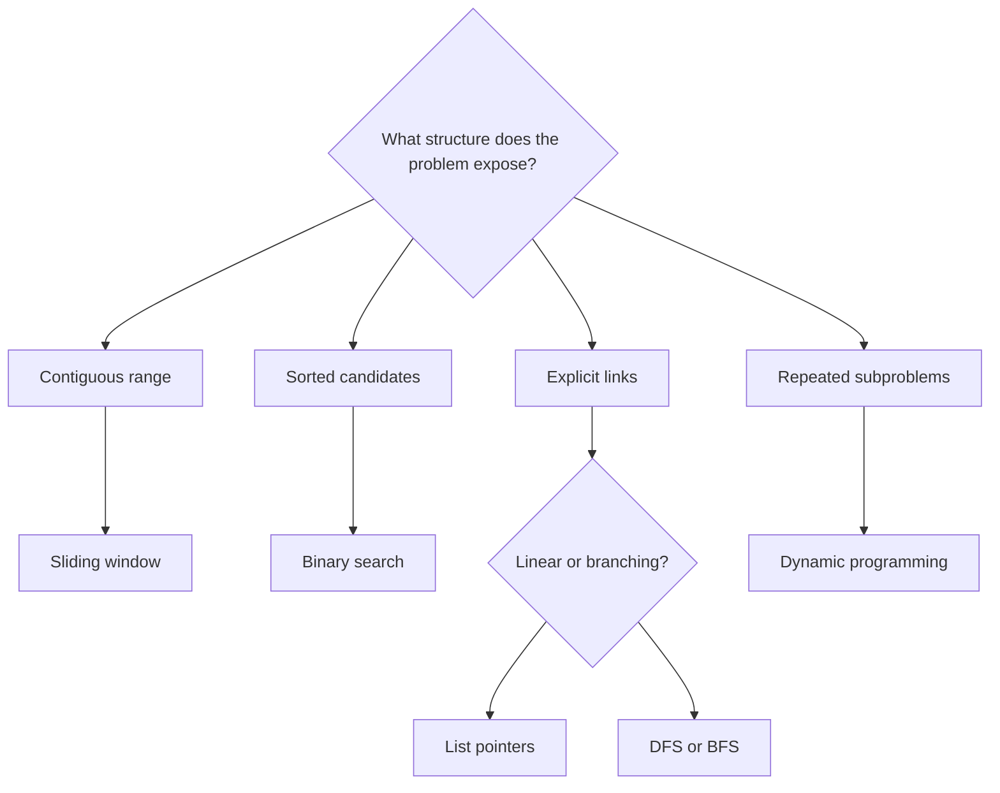
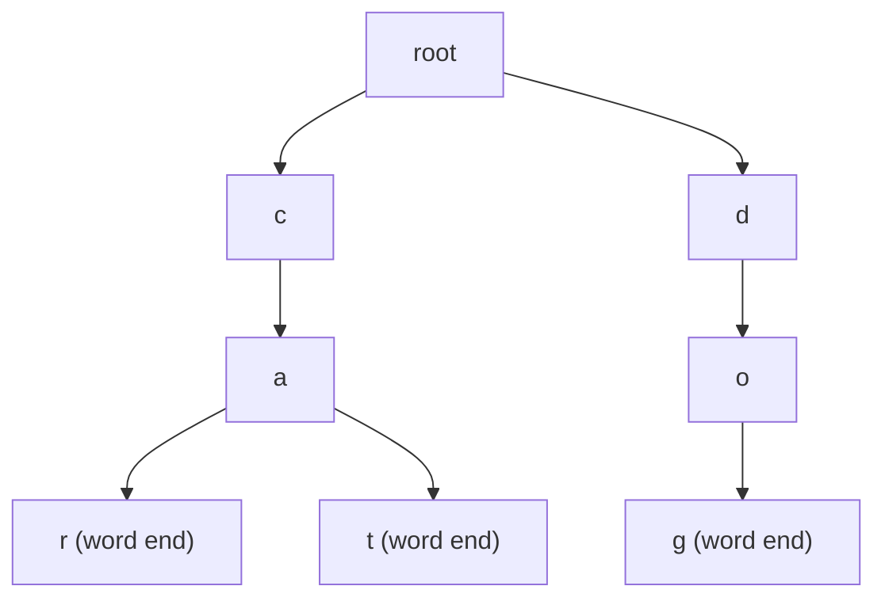

# Pattern atlas

[Problem catalog](problems.md) · [All pattern tags](pattern-index.md) · [Repository](../README.md) · [Roadmap](roadmap.md)

A pattern is useful when it explains what information to retain and why other information can be discarded. Start with the input's structure, then check whether the proposed invariant really permits the next move.

This is a starting point. A contiguous-range problem only supports a sliding window if its constraint allows safe boundary movement; a sorted input may instead favor two pointers. Hashing and stacks often supply the state inside another pattern.

## Hashing and counting

**Recognition:** the next step needs a previously seen value, a frequency, or a signature that groups equivalent inputs.

**State:** a map from value to index, a set of seen values, or a frequency vector. Decide whether multiplicity matters before choosing a set.

| Problem | Key distinction |
|---|---|
| [Two Sum](../problems/0001-two-sum/README.md) | Look up a complement among earlier indexes. |
| [Contains Duplicate](../problems/0217-contains-duplicate/README.md) | Membership is enough; counts are unnecessary. |
| [Longest Consecutive Sequence](../problems/0128-longest-consecutive-sequence/README.md) | Only values without a predecessor start scans. |
| [Valid Sudoku](../problems/0036-valid-sudoku/README.md) | Track row, column, and box membership separately. |
| [Valid Anagram](../problems/0242-valid-anagram/README.md) | Equal sets do not imply equal frequencies. |
| [Group Anagrams](../problems/0049-group-anagrams/README.md) | Use an immutable signature as a grouping key. |
| [Top K Frequent Elements](../problems/0347-top-k-frequent-elements/README.md) | Count first, then select by frequency buckets. |

Hash-table complexity is usually expected rather than worst-case constant time. Include signature construction in the complexity calculation.

## Two pointers

**Recognition:** ordered candidates or paired endpoints allow one comparison to eliminate many alternatives.

**State:** two positions with a rule that justifies moving exactly one of them. Sorting may make that rule possible, but its cost and effects belong in the explanation.

| Problem | Safe move |
|---|---|
| [Valid Palindrome](../problems/0125-valid-palindrome/README.md) | Skip nonalphanumeric characters, then compare matching endpoints. |
| [Container With Most Water](../problems/0011-container-with-most-water/README.md) | Move the shorter side because keeping it while reducing width cannot improve the area. |
| [3Sum](../problems/0015-3sum/README.md) | Fix one value and move a pair through the sorted remainder; handle duplicates deliberately. |
| [Two Sum II](../problems/0167-two-sum-ii-input-array-is-sorted/README.md) | Sorted values justify moving the smaller or larger endpoint. |
| [Move Zeroes](../problems/0283-move-zeroes/README.md) | The written prefix contains every encountered nonzero value in original order. |

Do not apply a pointer movement rule only because it looks familiar. Explain the candidates eliminated by that move.

## Prefix and suffix state

**Recognition:** an answer needs information from everything before or after an index.

**State:** a summary of a processed prefix, such as its minimum or product. A second pass can provide the corresponding suffix summary.

- [Best Time to Buy and Sell Stock](../problems/0121-best-time-to-buy-and-sell-stock/README.md): retain the cheapest earlier buy price.
- [Product of Array Except Self](../problems/0238-product-of-array-except-self/README.md): combine products from either side without dividing.
- [Subarray Sum Equals K](../problems/0560-subarray-sum-equals-k/README.md): count earlier prefix sums equal to the current sum minus k; negative values prevent a simple shrinking sum window.

Distinguish output storage from auxiliary storage. Consider zero values and integer limits before using division or accumulating products.

## Sliding window

**Recognition:** a contiguous substring or subarray must satisfy a condition that can be updated as elements enter or leave.

**State:** boundary positions and a summary of the current window. State whether the width is fixed or variable.

| Problem | Window condition |
|---|---|
| [Longest Substring Without Repeating Characters](../problems/0003-longest-substring-without-repeating-characters/README.md) | No repeated character within the current boundary. |
| [Longest Repeating Character Replacement](../problems/0424-longest-repeating-character-replacement/README.md) | Width minus the most frequent count is at most k. |
| [Permutation in String](../problems/0567-permutation-in-string/README.md) | A fixed-width window has the required letter counts. |
| [Minimum Window Substring](../problems/0076-minimum-window-substring/README.md) | Every required occurrence is covered before the left boundary shrinks. |
| [Minimum Size Subarray Sum](../problems/0209-minimum-size-subarray-sum/README.md) | Positive values make shrinking a valid sum window safe. |

Check that the left boundary never moves backward. Recomputing a maximum over 26 letters is constant work for that fixed alphabet; the same argument does not apply to an unbounded alphabet.

[Sliding Window Maximum](../problems/0239-sliding-window-maximum/README.md) adds a monotonic deque: an older, smaller value is dominated by a newer value that expires later. Track indexes to separate expiry from value comparisons. The [worked trace](traces.md) shows the deque after each completed window.

## Stacks and monotonic stacks

**Recognition:** the newest unresolved item must be handled before earlier ones, or a new value resolves a suffix of pending candidates.

**State:** unmatched openings, values with cached prefix minima, or indexes ordered by their values.

| Problem | Stack invariant |
|---|---|
| [Valid Parentheses](../problems/0020-valid-parentheses/README.md) | Openings are stored in nesting order. |
| [Min Stack](../problems/0155-min-stack/README.md) | Every entry remembers its prefix minimum. |
| [Evaluate Reverse Polish Notation](../problems/0150-evaluate-reverse-polish-notation/README.md) | Operators consume the two latest complete operand values in their original order. |
| [Daily Temperatures](../problems/0739-daily-temperatures/README.md) | Pending days have nonincreasing temperatures and no known warmer future day. |

For a monotonic stack, count total pushes and pops rather than multiplying nested loop bounds. Equality handling matters: an equal temperature is not a warmer day.

## Binary search

**Recognition:** a comparison can identify a half that cannot contain the answer, or a predicate changes from false to true once.

**State:** a candidate interval with an explicit inclusive or half-open convention.

| Problem | Elimination rule |
|---|---|
| [Binary Search](../problems/0704-binary-search/README.md) | Sorted order places the target on one side of the middle. |
| [Search in Rotated Sorted Array](../problems/0033-search-in-rotated-sorted-array/README.md) | One half is sorted; its value range determines the safe discard. |
| [Find Minimum in Rotated Sorted Array](../problems/0153-find-minimum-in-rotated-sorted-array/README.md) | Compare the middle with the right endpoint to retain the minimum. |
| [Search a 2D Matrix](../problems/0074-search-a-2d-matrix/README.md) | Matrix ordering supports a virtual flattened sorted array. |
| [Koko Eating Bananas](../problems/0875-koko-eating-bananas/README.md) | Feasibility changes once as eating speed increases. |

Verify that every update shrinks the interval and that endpoints remain searchable. Distinct values are an important assumption in the rotated-array entries.

## Linked lists

**Recognition:** changes operate on links rather than random-access positions.

**State:** references to the current node, the following node, and the head or tail of the result built so far.

- [Reverse Linked List](../problems/0206-reverse-linked-list/README.md): save the next link before overwriting it.
- [Merge Two Sorted Lists](../problems/0021-merge-two-sorted-lists/README.md): attach the smaller available head to the result tail.
- [Remove Nth Node From End](../problems/0019-remove-nth-node-from-end-of-list/README.md): a fixed pointer gap identifies the predecessor.
- [Reorder List](../problems/0143-reorder-list/README.md): split, reverse, and weave nodes in place; the method returns `None`.

An output with the right values can still contain a cycle or reuse a node incorrectly. Structural behavior belongs in the tests as well as the explanation.

[Linked List Cycle](../problems/0141-linked-list-cycle/README.md) compares pointer identities using two traversal speeds. [Reverse Nodes in k-Group](../problems/0025-reverse-nodes-in-k-group/README.md) first confirms a complete group before changing its links. [Palindrome Linked List](../problems/0234-palindrome-linked-list/README.md) restores the reversed suffix; its tests inspect the original nodes and links afterward.

## Trees

**Recognition:** parent-child relationships determine traversal order, subtree state, or globally constrained values.

**State:** pending nodes plus the depth, previous value, bounds, or child results needed by the task.

| Problem | Traversal purpose |
|---|---|
| [Level Order Traversal](../problems/0102-binary-tree-level-order-traversal/README.md) | BFS separates levels by the queue size at the start of a round. |
| [Balanced Binary Tree](../problems/0110-balanced-binary-tree/README.md) | Postorder processing obtains both child heights before checking a parent. |
| [Validate BST](../problems/0098-validate-binary-search-tree/README.md) | Strict inorder growth enforces ancestor constraints, not just parent comparisons. |
| [Kth Smallest in a BST](../problems/0230-kth-smallest-element-in-a-bst/README.md) | Stop an ordered traversal at the requested rank. |
| [Right Side View](../problems/0199-binary-tree-right-side-view/README.md) | Right-first DFS records the first node reached at each depth. |

Tree equality also includes shape: [Same Tree](../problems/0100-same-tree/README.md) and [Subtree of Another Tree](../problems/0572-subtree-of-another-tree/README.md) compare absent child positions. Iterative traversal avoids Python's recursion-depth limit; auxiliary space still depends on retained state and traversal shape.

[Preorder/Inorder Reconstruction](../problems/0105-construct-binary-tree-from-preorder-and-inorder-traversal/README.md) uses traversal boundaries to decide when to attach a left child or finish ancestors. [Maximum Path Sum](../problems/0124-binary-tree-maximum-path-sum/README.md) distinguishes the single branch returned to a parent from a path joining two branches at the current node.

## Intervals and greedy boundaries

**Recognition:** ranges overlap, cover positions, or compete for a limited resource.

**State:** the last merged range or the earliest ending compatible choice. Decide whether touching endpoints count as overlap for the particular problem.

| Problem | State and boundary |
|---|---|
| [Merge Intervals](../problems/0056-merge-intervals/README.md) | Sort starts, then extend the final output interval while overlap continues. |
| [Insert Interval](../problems/0057-insert-interval/README.md) | Scan ranges before, overlapping, and after the new interval. |
| [Non-overlapping Intervals](../problems/0435-non-overlapping-intervals/README.md) | An earlier finishing interval leaves at least as much room for later choices. |

A greedy rule needs an exchange argument. [Car Fleet](../problems/0853-car-fleet/README.md) offers another ordered-boundary example: scan from the destination backward and compare arrival times.

## Heaps and streaming selection

**Recognition:** the next step needs an extreme value, or the full input need not be retained to answer a rank query.

**State:** a small ordered frontier or partitions whose roots summarize the answer.

| Problem | Heap invariant |
|---|---|
| [Kth Largest in an Array](../problems/0215-kth-largest-element-in-an-array/README.md) | The min-heap retains the k largest values seen so far. |
| [Kth Largest in a Stream](../problems/0703-kth-largest-element-in-a-stream/README.md) | The same retained set survives between calls. |
| [Median from Data Stream](../problems/0295-find-median-from-data-stream/README.md) | Lower values precede upper values, with partition sizes differing by at most one. |
| [Last Stone Weight](../problems/1046-last-stone-weight/README.md) | Repeatedly retrieve the two largest current stones. |

Python's `heapq` is a min-heap; a sign transform supplies max-heap behavior. A heap orders its root, not every array position. The C++ Kth Largest counterpart instead uses partition selection; see [language notes](cpp-notes.md).

## Tries and prefix state

**Recognition:** many words share prefixes, or a query advances through one character position at a time.

**State:** child edges by character and a separate terminal marker for complete words.

Here `car` and `cat` share the `c` then `a` path. Reaching that prefix does not make `ca` a stored word; only a terminal marker does. `dog` starts a different branch.

- [Implement Trie](../problems/0208-implement-trie-prefix-tree/README.md): distinguish exact-word search from prefix lookup.
- [Design Add and Search Words](../problems/0211-design-add-and-search-words-data-structure/README.md): a wildcard expands the search frontier across child branches.

A literal lookup follows one path. Wildcard search can explore several paths, so its complexity must include that branching.

## Backtracking

**Recognition:** an answer is a collection of choices, and partial choices can be extended or rejected.

**State:** the partial result and exactly the information needed to describe legal next choices.

| Problem | What prevents invalid or duplicate paths |
|---|---|
| [Subsets](../problems/0078-subsets/README.md) | Each input position is included or excluded once. |
| [Permutations](../problems/0046-permutations/README.md) | Every position selects one unused value. |
| [Combination Sum](../problems/0039-combination-sum/README.md) | A nondecreasing candidate index avoids different orderings of the same combination. |
| [Generate Parentheses](../problems/0022-generate-parentheses/README.md) | Openings stay within the limit, and closings never exceed openings. |

Restore mutable path state after returning from a choice. Count output construction as well as search work: exponential output cannot be produced in linear total time.

## Graph reachability, components, and dependencies

**Recognition:** edges define reachable regions, simultaneous spread, component membership, or prerequisites.

**State:** a frontier and visited policy, component representatives, or remaining indegrees.

| Family | Representative problem | Invariant |
|---|---|---|
| Components | [Number of Islands](../problems/0200-number-of-islands/README.md) · [Max Area of Island](../problems/0695-max-area-of-island/README.md) | Mark discovered cells once and finish one connected land region. |
| Reverse reachability | [Pacific Atlantic Water Flow](../problems/0417-pacific-atlantic-water-flow/README.md) | Search from each ocean toward cells that could drain into it. |
| Multi-source BFS | [Rotting Oranges](../problems/0994-rotting-oranges/README.md) | One queue layer represents one elapsed spreading step. |
| Topological processing | [Course Schedule](../problems/0207-course-schedule/README.md) · [Course Schedule II](../problems/0210-course-schedule-ii/README.md) | Ready vertices have no unprocessed prerequisites. |
| Union-find | [Redundant Connection](../problems/0684-redundant-connection/README.md) | An edge connecting equal representatives closes a cycle. |

Directed dependencies and undirected connectivity need different reasoning. A topological order is a witness rather than one uniquely determined list: Course Schedule II's semantic checker requires every course exactly once and every prerequisite before its dependent.

## Weighted graphs

| Problem | State and assumption |
|---|---|
| [Network Delay Time](../problems/0743-network-delay-time/README.md) | Dijkstra settles shortest distances with nonnegative edges; stale heap candidates are ignored. |
| [Cheapest Flights Within K Stops](../problems/0787-cheapest-flights-within-k-stops/README.md) | Each relaxation round adds at most one edge; read the previous round to enforce the stop limit. |
| [Min Cost to Connect All Points](../problems/1584-min-cost-to-connect-all-points/README.md) | Prim tracks the cheapest edge joining each remaining point to the connected set. |

A shortest-path tree and a minimum spanning tree optimize different quantities. The [Dijkstra trace](traces.md) shows why an improved candidate can coexist with an obsolete one in the heap.

## Stateful designs and range queries

| Problem | Retained information |
|---|---|
| [LRU Cache](../problems/0146-lru-cache/README.md) | Key lookup and an ordering that changes on successful reads and writes. |
| [TimeMap](../problems/0981-time-based-key-value-store/README.md) | Increasing timestamp histories per key; find the latest entry no later than the query. |
| [Snapshot Array](../problems/1146-snapshot-array/README.md) | Per-index change histories; repeated writes within one snapshot replace its current entry. |
| [Mutable Range Sum](../problems/0307-range-sum-query-mutable/README.md) | Fenwick prefix blocks plus original values for replacement deltas. |
| [Immutable 2D Range Sum](../problems/0304-range-sum-query-2d-immutable/README.md) | A padded prefix table supports rectangle inclusion-exclusion. |

Define state after every operation and test complete legal histories against a simpler model. The [LRU and Fenwick traces](traces.md) expose how a successful read or point replacement changes retained state.

## Sequence and grid dynamic programming

**Recognition:** choices lead to overlapping subproblems with the same sufficient state.

**State:** define precisely what a table entry means, write its base cases, then derive dependencies before compressing storage.

| Problem | State meaning |
|---|---|
| [House Robber](../problems/0198-house-robber/README.md) · [House Robber II](../problems/0213-house-robber-ii/README.md) | Best value for a nonadjacent prefix; a cycle becomes two linear endpoint exclusions. |
| [Maximum Subarray](../problems/0053-maximum-subarray/README.md) | Best nonempty subarray ending at the current index. |
| [Coin Change](../problems/0322-coin-change/README.md) | Fewest coins needed for each reachable amount. |
| [Decode Ways](../problems/0091-decode-ways/README.md) | Number of valid decodings for a prefix, including zero-handling rules. |
| [Unique Paths](../problems/0062-unique-paths/README.md) | Number of ways to reach a grid position from its permitted predecessors. |
| [Longest Common Subsequence](../problems/1143-longest-common-subsequence/README.md) | Best shared subsequence length for two prefixes. |
| [Longest Increasing Subsequence](../problems/0300-longest-increasing-subsequence/README.md) | Minimum possible tail for each achieved subsequence length. |

LIS's tails array supports binary search, but the array itself need not be one realized subsequence. In compressed grid DP, an entry can represent the preceding row until it is updated and the current row afterward. Preserve old values long enough for every transition that depends on them.

Loop direction encodes reuse: [Partition Equal Subset Sum](../problems/0416-partition-equal-subset-sum/README.md) updates totals backward to use each number once, while [Coin Change II](../problems/0518-coin-change-ii/README.md) scans amounts forward within each denomination to permit repeated coins without counting orderings. [Edit Distance](../problems/0072-edit-distance/README.md), [Distinct Subsequences](../problems/0115-distinct-subsequences/README.md), and [Interleaving String](../problems/0097-interleaving-string/README.md) each require a different meaning for a pair of prefix positions.

## Fixed-width bit operations

[Reverse Bits](../problems/0190-reverse-bits/README.md) follows exactly 32 input positions. [Counting Bits](../problems/0338-counting-bits/README.md) reuses the count of a smaller integer. Keep the integer width, signedness, and state transition explicit; Python's unbounded integers do not automatically impose a fixed word size.

## Prefix reuse in string matching

[First Occurrence in a String](../problems/0028-find-the-index-of-the-first-occurrence-in-a-string/README.md) uses KMP's prefix table to recover after a mismatch. The table gives the longest proper prefix that is also a suffix of the portion already matched. This suffix can remain useful without rereading earlier text characters; arbitrary substring restarting loses that information. See the [KMP trace](traces.md).

Do not confuse subsequences with contiguous matches. [Longest Common Subsequence](../problems/1143-longest-common-subsequence/README.md) permits skipped positions; KMP matches consecutive characters. [Wildcard Matching](../problems/0044-wildcard-matching/README.md) must additionally account for a star consuming different numbers of characters.

## Interval dynamic programming

**Recognition:** removing or combining objects changes their neighbors, but a final operation can separate two independent subranges.

**State:** a range with clear endpoint conventions and any boundary information that remains fixed while it is solved.

| Problem | Dependency that determines the transition |
|---|---|
| [Burst Balloons](../problems/0312-burst-balloons/README.md) | Choose the last balloon so its two surviving boundary values are known. |
| [Longest Palindromic Subsequence](../problems/0516-longest-palindromic-subsequence/README.md) | Compare endpoint characters and depend on smaller ranges. |
| [Palindrome Partitioning II](../problems/0132-palindrome-partitioning-ii/README.md) | A palindromic final segment connects a known prefix optimum to a new endpoint. |

Fill states in an order that makes every required smaller state available. The number of states and the work inside each transition are separate factors; an O(n²) table does not imply O(n²) time.

## DFS relationships and graph bridges

[Critical Connections](../problems/1192-critical-connections-in-a-network/README.md) records discovery times and low-link values. A child's subtree can get around its parent edge exactly when it can reach that parent or an earlier ancestor without using the parent edge. If its low-link value is greater than the parent's discovery time, that edge is a bridge.

An iterative DFS needs to retain the information normally stored in a recursive frame: the next neighbor to explore, the parent edge, and the postorder update to apply when a child finishes. Returning from a child is a meaningful transition, not just another queue visit. The [bridge trace](traces.md) compares a triangle with an attached leaf.

[Lowest Common Ancestor](../problems/0236-lowest-common-ancestor-of-a-binary-tree/README.md) also depends on relationships rather than values alone. The answer must be an existing tree node, and a node can be its own ancestor. The BST variant can instead use ordering to discard a whole side.

## Operation histories and event boundaries

[My Calendar I](../problems/0729-my-calendar-i/README.md) uses half-open intervals: an event ending exactly when another begins does not overlap. [My Calendar II](../problems/0731-my-calendar-ii/README.md) must reject triple overlap and undo every effect of a rejected booking. Tests compare the whole accepted history with an independent overlap model.

[Circular Queue](../problems/0622-design-circular-queue/README.md) and [Circular Deque](../problems/0641-design-circular-deque/README.md) need separate logical size and wrapped positions to distinguish empty from full. [Online Stock Span](../problems/0901-online-stock-span/README.md) compresses dominated prices together with their accumulated spans; many pops on one call still allow an amortized bound across a history.

The [practice routes](practice.md) group related problems by the invariant you should explain before attempting the next variation.

## Use the connections

A useful comparison sequence is **Two Sum → Group Anagrams → Permutation in String**: a map supports lookup, a signature supports grouping, and a changing signature supports a window. Another is **Valid Parentheses → Min Stack → Daily Temperatures**, where the same last-in, first-out structure maintains three different invariants. Compare **Number of Islands → Rotting Oranges → Course Schedule** to see how a frontier changes from component exploration to elapsed layers to dependency readiness.

After reading, try to explain which input assumption permits each discarded candidate. Then change that assumption using the follow-up question in the problem's notes.
