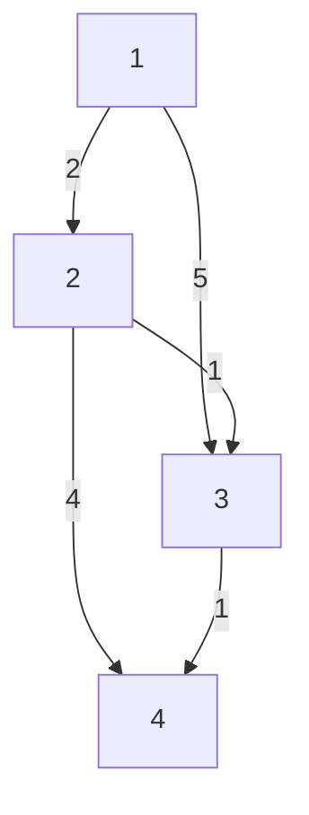

# Four algorithm traces

[Problem catalog](problems.md) · [Pattern atlas](patterns.md) · [Verification](verification.md)

These small inputs expose the state behind the algorithm. Reconstruct each row before running the implementation, then explain why a discarded candidate cannot be needed later.

## A sliding window keeps unresolved candidates

[Sliding Window Maximum](../problems/0239-sliding-window-maximum/README.md), with `nums = [1,3,-1,-3,5,3,6,7]` and `k = 3`.

The deque stores indexes in increasing order and values in nonincreasing order. Expired indexes leave the front. A new value can remove smaller candidates from the back because it is larger and expires later.

| New index | Current window | Deque indexes | Deque values | Maximum |
| ---: | --- | --- | --- | ---: |
| 2 | `[1,3,-1]` | `[1,2]` | `[3,-1]` | 3 |
| 3 | `[3,-1,-3]` | `[1,2,3]` | `[3,-1,-3]` | 3 |
| 4 | `[-1,-3,5]` | `[4]` | `[5]` | 5 |
| 5 | `[-3,5,3]` | `[4,5]` | `[5,3]` | 5 |
| 6 | `[5,3,6]` | `[6]` | `[6]` | 6 |
| 7 | `[3,6,7]` | `[7]` | `[7]` | 7 |

Output: `[3,3,5,5,6,7]`. Each index enters and leaves the deque at most once, so all deque updates together take O(n) time.

**Change one assumption:** if values can be updated inside the current window, an eliminated candidate might become useful again. The original discard argument depends on the values remaining fixed.

## LRU combines lookup with recency

[LRU Cache](../problems/0146-lru-cache/README.md), capacity 2. The table lists keys from least recent to most recent, independently of the implementation's physical list orientation.

| Operation | Return | Recency order | Reason |
| --- | --- | --- | --- |
| `put(1,10)` | `None` | `[1]` | Insert one entry. |
| `put(2,20)` | `None` | `[1,2]` | The newest write becomes most recent. |
| `get(1)` | `10` | `[2,1]` | A successful read changes recency. |
| `put(3,30)` | `None` | `[1,3]` | Evict key 2, then insert key 3. |
| `get(2)` | `-1` | `[1,3]` | A miss does not revive an evicted entry. |
| `put(1,40)` | `None` | `[3,1]` | Replace the value and refresh key 1's position. |

A hash table finds an entry; a linked ordering moves that entry without scanning the cache. The two structures must agree after every eviction and replacement.

**Change one assumption:** add an expiration time. Recency alone no longer identifies all entries that should be removed.

## A Fenwick tree stores selected prefix blocks

[Range Sum Query — Mutable](../problems/0307-range-sum-query-mutable/README.md), initially `nums = [1,3,5,7]`. Public indexes are zero-based; internal Fenwick positions are one-based.

| Internal position | Zero-based range represented | Initial sum |
| ---: | --- | ---: |
| 1 | `[0,0]` | 1 |
| 2 | `[0,1]` | 4 |
| 3 | `[2,2]` | 5 |
| 4 | `[0,3]` | 16 |

`update(1,10)` changes the old value 3 by delta 7. Starting at internal position 2, repeatedly add the lowest set bit to visit every stored block containing that value:

| Affected position | Before | After |
| ---: | ---: | ---: |
| 2 | 4 | 11 |
| 4 | 16 | 23 |

The inclusive public query `sumRange(1,3)` becomes a difference of prefixes:

`prefix(4) - prefix(1) = 23 - 1 = 22`, matching `10 + 5 + 7`.

An update adds the lowest set bit to the internal position; a prefix query subtracts it. Each walk visits O(log n) positions. Keeping the original values is necessary to compute the delta for a replacement update.

**Change one assumption:** support adding a value to an entire interval. One point-update tree needs an additional representation to make both operations efficient.

## Dijkstra distinguishes a candidate from a shortest distance

[Network Delay Time](../problems/0743-network-delay-time/README.md), source 1. Edge labels are nonnegative travel times.



| Settled node | Shortest distance | Improvement made |
| ---: | ---: | --- |
| 1 | 0 | Offer distance 2 to node 2 and distance 5 to node 3. |
| 2 | 2 | Improve node 3 to 3; offer node 4 distance 6. |
| 3 | 3 | Improve node 4 to 4. |
| 4 | 4 | All nodes have their shortest distance. |

The old heap candidates `(5,3)` and `(6,4)` are obsolete. If processed, they must be skipped rather than used to undo a shorter distance. The network delay is the maximum shortest distance: **4**.

Try the example directly:

```bash
python -m atlas run 743 --args '[[[1,2,2],[1,3,5],[2,3,1],[2,4,4],[3,4,1]],4,1]'
```

**Change one assumption:** allow negative edge weights. A settled node can later receive a shorter distance, so Dijkstra's settlement proof no longer applies.

