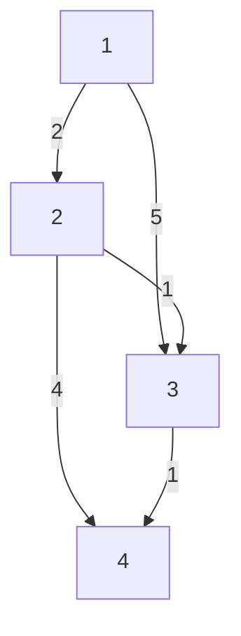
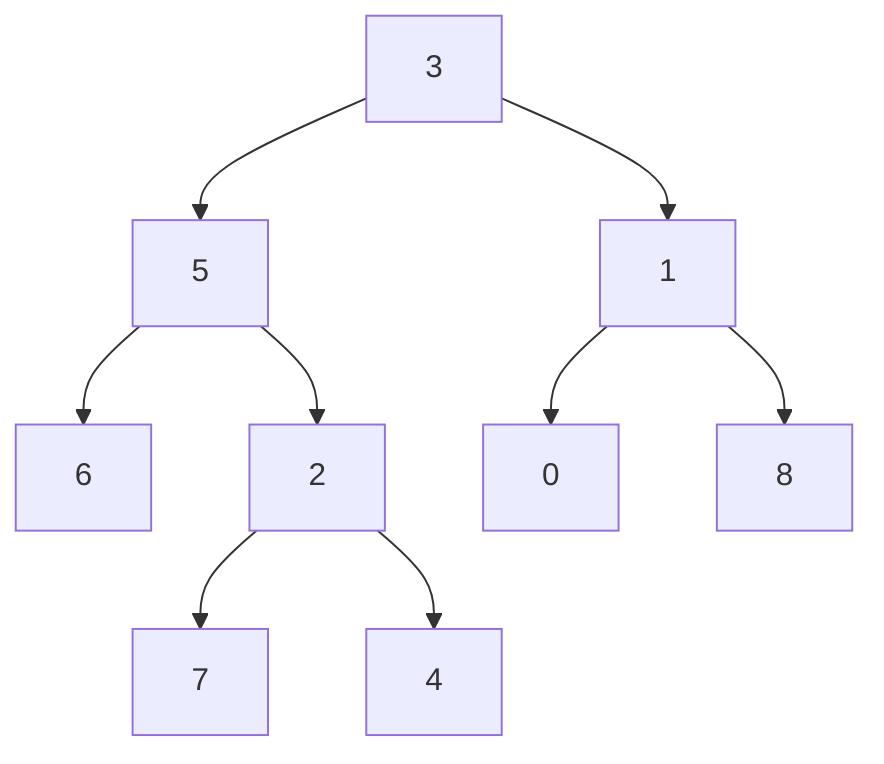
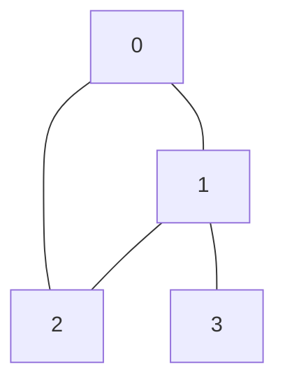

# Eight algorithm traces

[Problem catalog](problems.md) · [Pattern atlas](patterns.md) · [Verification](verification.md)

These small inputs expose the state behind the algorithm. Reconstruct each row before running the implementation, then explain why a discarded candidate cannot be needed later.

## A sliding window keeps unresolved candidates

[Sliding Window Maximum](../problems/0239-sliding-window-maximum/README.md), with `nums = [1,3,-1,-3,5,3,6,7]` and `k = 3`.

The deque stores indexes in increasing order and values in nonincreasing order. Expired indexes leave the front. A new value can remove smaller candidates from the back because it is larger and expires later.

| New index | Current window | Deque indexes | Deque values | Maximum |
| ---: | --- | --- | --- | ---: |
| 2 | `[1,3,-1]` | `[1,2]` | `[3,-1]` | 3 |
| 3 | `[3,-1,-3]` | `[1,2,3]` | `[3,-1,-3]` | 3 |
| 4 | `[-1,-3,5]` | `[4]` | `[5]` | 5 |
| 5 | `[-3,5,3]` | `[4,5]` | `[5,3]` | 5 |
| 6 | `[5,3,6]` | `[6]` | `[6]` | 6 |
| 7 | `[3,6,7]` | `[7]` | `[7]` | 7 |

Output: `[3,3,5,5,6,7]`. Each index enters and leaves the deque at most once, so all deque updates together take O(n) time.

**Change one assumption:** if values can be updated inside the current window, an eliminated candidate might become useful again. The original discard argument depends on the values remaining fixed.

## LRU combines lookup with recency

[LRU Cache](../problems/0146-lru-cache/README.md), capacity 2. The table lists keys from least recent to most recent, independently of the implementation's physical list orientation.

| Operation | Return | Recency order | Reason |
| --- | --- | --- | --- |
| `put(1,10)` | `None` | `[1]` | Insert one entry. |
| `put(2,20)` | `None` | `[1,2]` | The newest write becomes most recent. |
| `get(1)` | `10` | `[2,1]` | A successful read changes recency. |
| `put(3,30)` | `None` | `[1,3]` | Evict key 2, then insert key 3. |
| `get(2)` | `-1` | `[1,3]` | A miss does not revive an evicted entry. |
| `put(1,40)` | `None` | `[3,1]` | Replace the value and refresh key 1's position. |

A hash table finds an entry; a linked ordering moves that entry without scanning the cache. The two structures must agree after every eviction and replacement.

**Change one assumption:** add an expiration time. Recency alone no longer identifies all entries that should be removed.

## A Fenwick tree stores selected prefix blocks

[Range Sum Query — Mutable](../problems/0307-range-sum-query-mutable/README.md), initially `nums = [1,3,5,7]`. Public indexes are zero-based; internal Fenwick positions are one-based.

| Internal position | Zero-based range represented | Initial sum |
| ---: | --- | ---: |
| 1 | `[0,0]` | 1 |
| 2 | `[0,1]` | 4 |
| 3 | `[2,2]` | 5 |
| 4 | `[0,3]` | 16 |

`update(1,10)` changes the old value 3 by delta 7. Starting at internal position 2, repeatedly add the lowest set bit to visit every stored block containing that value:

| Affected position | Before | After |
| ---: | ---: | ---: |
| 2 | 4 | 11 |
| 4 | 16 | 23 |

The inclusive public query `sumRange(1,3)` becomes a difference of prefixes:

`prefix(4) - prefix(1) = 23 - 1 = 22`, matching `10 + 5 + 7`.

An update adds the lowest set bit to the internal position; a prefix query subtracts it. Each walk visits O(log n) positions. Keeping the original values is necessary to compute the delta for a replacement update.

**Change one assumption:** support adding a value to an entire interval. One point-update tree needs an additional representation to make both operations efficient.

## Dijkstra distinguishes a candidate from a shortest distance

[Network Delay Time](../problems/0743-network-delay-time/README.md), source 1. Edge labels are nonnegative travel times.



| Settled node | Shortest distance | Improvement made |
| ---: | ---: | --- |
| 1 | 0 | Offer distance 2 to node 2 and distance 5 to node 3. |
| 2 | 2 | Improve node 3 to 3; offer node 4 distance 6. |
| 3 | 3 | Improve node 4 to 4. |
| 4 | 4 | All nodes have their shortest distance. |

The old heap candidates `(5,3)` and `(6,4)` are obsolete. If processed, they must be skipped rather than used to undo a shorter distance. The network delay is the maximum shortest distance: **4**.

Try the example directly:

```bash
python -m atlas run 743 --args '[[[1,2,2],[1,3,5],[2,3,1],[2,4,4],[3,4,1]],4,1]'
```

**Change one assumption:** allow negative edge weights. A settled node can later receive a shorter distance, so Dijkstra's settlement proof no longer applies.

## KMP retains a viable prefix after a mismatch

[First Occurrence in a String](../problems/0028-find-the-index-of-the-first-occurrence-in-a-string/README.md), text `abababacaba`, pattern `ababaca`.

The prefix table records the longest proper prefix that is also a suffix ending at each pattern position:

| Pattern index | 0 | 1 | 2 | 3 | 4 | 5 | 6 |
| --- | --- | --- | --- | --- | --- | --- | --- |
| Character | a | b | a | b | a | c | a |
| Prefix length | 0 | 0 | 1 | 2 | 3 | 0 | 1 |

After consuming text positions 0 through 4, five pattern characters match. The next text character is `b`, while pattern position 5 expects `c`.

| Text position | Character | Matched length before | Transition | Matched length after |
| ---: | --- | ---: | --- | ---: |
| 5 | b | 5 | Fall back to prefix length 3; compare the same text character with pattern position 3. | 4 |
| 6 | a | 4 | Extend the surviving prefix. | 5 |
| 7 | c | 5 | Extend it again. | 6 |
| 8 | a | 6 | Complete the seven-character pattern. | 7 |

The match begins at `8 - 7 + 1 = 2`. The fallback keeps the already matched suffix `aba`; it does not move the text position backward.

**Change one assumption:** match arbitrary wildcards. Equality-based prefix reuse needs a new argument because matching one character may no longer imply matching the same character elsewhere.

## Interval DP chooses the final balloon

[Burst Balloons](../problems/0312-burst-balloons/README.md), `nums = [3,1,5,8]`. Add fixed boundary values to obtain `[1,3,1,5,8,1]`.

Let `dp(left,right)` cover balloons strictly inside those boundary positions. If `last` is the final balloon burst inside the interval, its neighbors are the two fixed boundaries. The resulting score is:

`dp(left,last) + values[left] * values[last] * values[right] + dp(last,right)`.

Choosing the first balloon would leave changing neighbors; choosing the last makes the two smaller intervals independent. One optimal bursting order shows the resulting score:

| Value burst | Neighbors at that moment | Coins | Running total |
| ---: | --- | ---: | ---: |
| 1 | 3 and 5 | 15 | 15 |
| 5 | 3 and 8 | 120 | 135 |
| 3 | 1 and 8 | 24 | 159 |
| 8 | 1 and 1 | 8 | 167 |

The final choice 8 combines the optimal left interval score 159, an empty right interval, and 8 boundary coins. The algorithm considers every possible final choice, yielding **167**.

**Change one assumption:** reward a burst using the original neighbors. The changing-adjacency dependency disappears, so this interval state may be unnecessary.

## LCA includes a node as its own ancestor

[Lowest Common Ancestor](../problems/0236-lowest-common-ancestor-of-a-binary-tree/README.md), tree `[3,5,1,6,2,0,8,null,null,7,4]`.



| Query nodes | First upward path | Second upward path until shared | LCA |
| --- | --- | --- | ---: |
| 7 and 4 | `7 → 2 → 5 → 3` | `4 → 2` | 2 |
| 5 and 4 | `5 → 3` | `4 → 2 → 5` | 5 |

The answer is an existing node, not a newly constructed node holding the same value. The local adapter resolves query values within the same tree; direct structural tests check identity and unchanged links.

**Change one assumption:** allow repeated node values. Query values no longer uniquely identify nodes, so the fixture representation would need explicit node references.

## A bridge has no route around its parent edge

[Critical Connections](../problems/1192-critical-connections-in-a-network/README.md), edges `[[0,1],[1,2],[2,0],[1,3]]`.



For a DFS visiting 0, 1, 2, then 3, discovery times and final low-link values are:

| Node | Discovery time | Lowest reachable discovery time |
| ---: | ---: | ---: |
| 0 | 0 | 0 |
| 1 | 1 | 0 |
| 2 | 2 | 0 |
| 3 | 3 | 3 |

Node 2 reaches ancestor 0 through the triangle, so its subtree can get around the edge from 1. Node 3 has no such route: `low[3] > discovery[1]`. Therefore **[1,3]** is the only bridge.

**Change one assumption:** allow parallel edges. Skipping every edge to the parent would hide a valid return route; traversal must distinguish the particular parent edge from another edge with the same endpoints.

